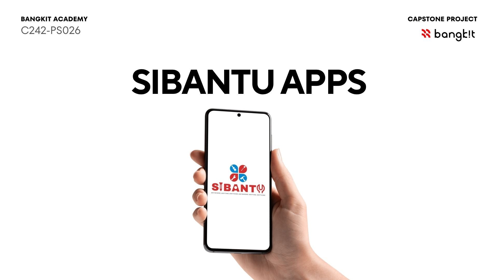
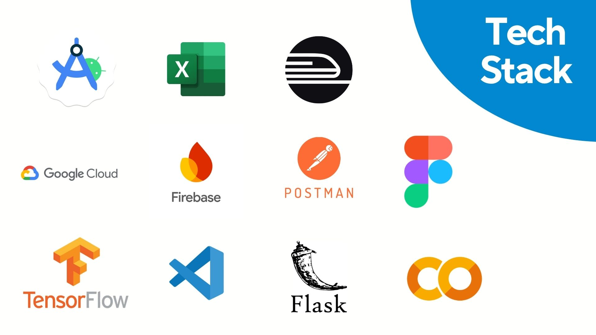
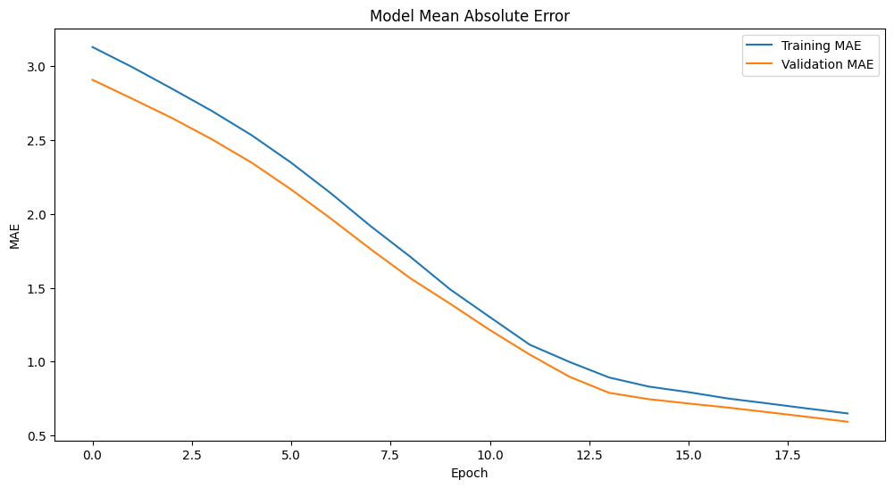

<p align="center">
  
</p>

# Bangkit 2024 Capstone Team : Si-Bantu (C242-PS026)

For our Capstone Project, we are collaborated with them consist of:

## Our Knights

|          Nama         | Bangkit-ID |       Path       |
|:---------------------:|:----------:|:----------------:|
|  Zeka Emo  |  M200B4KX4610  | Machine Learning |
|  Indra Mauludani Efendi  |  M200B4KY1975  | Machine Learning |
|   Aditya Putra Effendi    |  M200B4KY0113  |  Machine Learning |
|  Prabaswara Nasywa Maharani  |  c200b4kx3492  |  Cloud Computing |
|  Nalendra Faraz Putra Rahadyan  |  C200B4KY3233  |  Cloud Computing |
|    Dzikri Razzan Athallah      |  a200b4ky1223  |      Mobile Development     |
|    Togar Anthony Mario Sianturi      |  A2242180  |      Mobile Development     |


## Our Objectives

We are

<p align="center">
  
</p>

## Tech Stacks

<p align="center">
  
</p>

## Our Model Performance

SI-BANTU was trained on over **10,000 reviews** and achieved **85% accuracy** on the test dataset.

### Model Evaluation Metrics

The model's performance is evaluated using the following metrics:

- **Loss:** Measures the difference between the model's predicted outputs and the actual values. Lower loss indicates better model performance.
- **MAE (Mean Absolute Error):** Measures the average absolute difference between predicted and actual values. Lower MAE indicates more accurate predictions.

### Training Loss

The loss curve illustrates how the model's prediction error changes throughout the training process, providing insights into its learning progress and convergence.

<p align="center">
  
</p>

### Mean Absolute Error (MAE)

The MAE curve shows how the average absolute prediction error changes during training, helping evaluate the model's prediction accuracy.

<p align="center">
  
</p>

## Instalation
Make sure you intalled all this dependencies first on your local machine. You can use conda virtual env for making things easier with pip
```text
sklearn==0.24.2 
fastapi==‎0.64.0 
pandas==1.2.4
pydantic==0.28
tensorflow==2.3.0
uvicorn==0.8.6
h5py==2.10.0
python-multipart==0.0.5
numpy==1.18.0
```

For using our NLP Model, You must clone our repository first with this following command :

`git clone https://github.com/aplawtech/aplod.git`

after cloning the repository, go to the aplod directory and run the following command on your favorite CLI (make sure you are in /aplod directory) :

` uvicorn app:app --host=0.0.0.0 --port=${PORT:-5000} `

We already provide you all of the data set and NLP model, so you just need to run the command above

You can also test our API [Here](https://aplodfix-wk452lxpxq-et.a.run.app/predict)

## Library Used in Android Application
1. [RecyclerView](https://developer.android.com/guide/topics/ui/layout/recyclerview)
2. [Lifecycle](https://developer.android.com/jetpack/androidx/releases/lifecycle)
3. [Glide](https://github.com/bumptech/glide)
4. [CircleImageView by hdodenhof](https://github.com/hdodenhof/CircleImageView)
5. [Retrofit 2](https://square.github.io/retrofit/)
6. [Material Design](https://material.io/develop/android)

## Fork Repository
In order to duplicate our repository to become your repository on your own github account, you need to **fork** this repository </br>
 </br>
Forking repository allows you to modificate this project without affecting the original project.

## Clone Repository
Download code from branch "main" **OR** 
2. Clone Repository. Click on dropdown Code and **copy** HTTPS link
2. Clone Repository. Click on dropdown Code and **copy** HTTPS link <br/>
```
git clone https://github.com/aplawtech/aplod.git
```

### Next Step
1. Work on the project locally in your own computer
2. **Create new Branch** based on the feature you make using " git checkout -b <new_branch> " <br/>
Example :
```
git checkout -b layout-member
```
3. **Commit** changes to your branch. Don't forget to give proper commit message so other people can understand it <br/>
Example:
```
git commit -m "add layout-member"
```
4. **Push** to your branch <br/>
Example:
```
git push origin layout-member
```

## Project Update

**TBD** 
